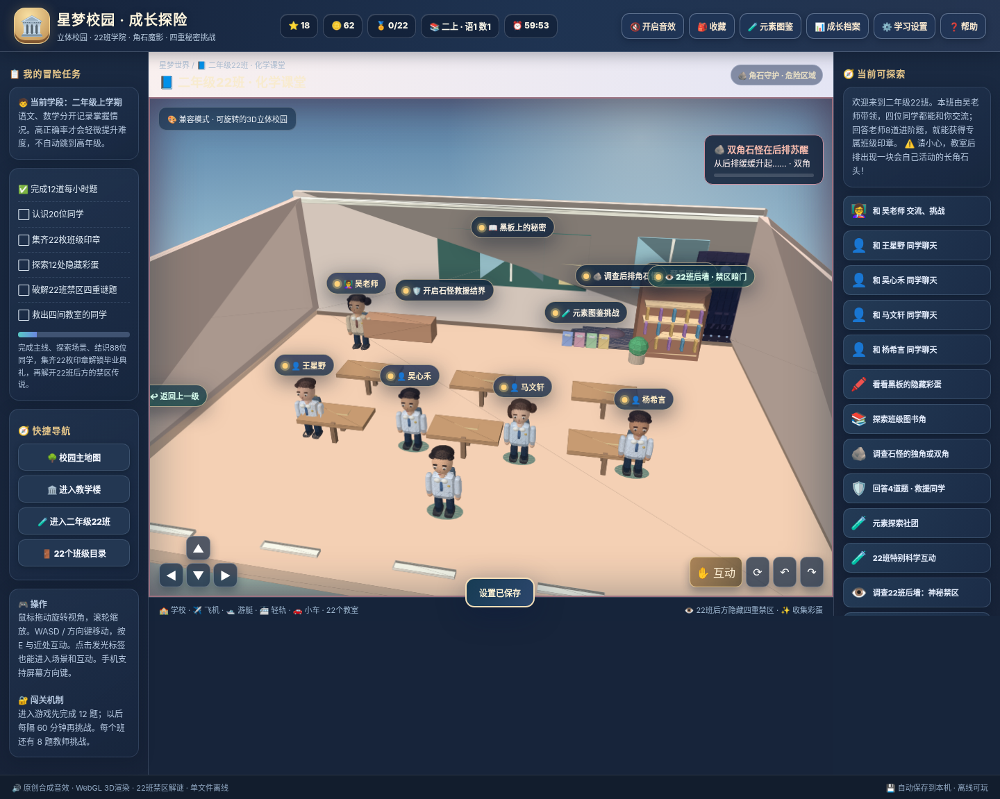

# 星梦校园 · 成长探险 / Xingmeng Campus Adventure

> 开源 3D 校园探索与儿童学习游戏。当前正式学习内容适配 **小学二年级上学期**，不是自动评价学生能力的正式教学或考试系统。

**版本：v0.9.0（2026-11-08）** | 游戏语言：简体中文 | 运行方式：浏览器、静态网页、离线单文件



## 立即游玩

本项目位于个人站点的 `xingmeng-campus-adventure/` 子目录。正式版由 `main` 分支发布到 <https://stephenpan.github.io/xingmeng-campus-adventure/>。测试分支的游戏可下载该分支的 `index.html` 离线试玩。

双击根目录的 `index.html`，用 Chrome 或 Edge 打开。电脑使用 WASD / 方向键移动、鼠标拖动旋转、滚轮缩放、E 键互动；手机使用屏幕方向键。小车和自行车使用 W 加速、S 倒车、A/D 转向、空格刹车。停稳后按 E 或点击「下车」。轻轨上车后按 W 或点击「发车」。

如果浏览器限制本地 `file://` 存储，可运行 `python3 -m http.server 8000` 后访问 `http://localhost:8000`。正式发布推荐 GitHub Pages。

## 玩法

- 开场和游戏右上角都可以切换三种模式。恐怖模式在教学楼、图书馆和花园增加三个独立遭遇。创造模式免疫追逐伤害，在创造工坊按 B 放置、按 X 拆除方块。生存模式有三颗心，体力持续下降，奔跑会加快消耗，零食恢复 34 点体力。三颗心用完会回到校园补给点。
- 校园广场的星星生成器可在三种模式开启。运行中每秒增加 800,000 颗星星，刷新页面可继续生成。关闭页面期间暂停计算。

- 一座可以实时旋转和行走的程序化 3D 校园，**22 个教室**及老师、虚构同学角色；深入探索机场、游艇、轻轨、汽车、图书馆和科学馆。
- 第一次进入及之后每隔 60 分钟进行 **12 道语文/数学题**（各 6 道）；老师为每班提供 **8 道挑战题**（语文 3、数学 3、科学兴趣 2）。答错可以看提示并重试，不会扣分或损失存档。
- 学习题目限制在当前学段内，初始从基础开始，根据最近答题正确率分别调整语文、数学和科学的难度，最多在**基础 → 标准 → 轻度拓展**间调整，不按游戏时长直接跳升年级。
- 二年级22班有独立**元素探索图鉴**，目前有 8 张元素卡片；不需要化学操作，且不是语数强制通关项目。
- 从校园南门步行进入学校街，再往东去小吃摊街、我的家街。三街地图也提供快捷导航。小吃摊街有自行车道、公路和轻轨东西站。自行车与小车都有加速、倒车、转向和刹车；轻轨沿轨道运行，到站停稳后下车。
- 水果铺、烘焙摊、热食摊出售六种小吃。使用游戏金币购买，买到的小吃可在零食袋里查看和食用。
- 我的家有五层，可探索客厅、卧室、科学室、模型工坊和屋顶花园。住宅街还有三位虚构同学的家，每家两层，可找同学聊天及收集纪念品。
- 灯笼洞、晶石洞、回声水洞以隧道相连。洞穴由同一份网格生成几何和岩壁碰撞。设计参考 [Godot 开源示例](https://github.com/godotengine/godot-demo-projects)与 [GridMap 示例教程](https://docs.godotengine.org/en/stable/tutorials/3d/using_gridmaps.html)，使用本项目自有的 WebGL 实现和美术。
- 校园东北角的旧钟楼有一段可选惊悚探索。灯光变化和脚步声会提示守钟人的行动，门边可随时返回校园。
- 4/9/15/22班的石怪速度为 v0.7 同档的十倍。按住 Shift 或屏幕冲刺按钮可加速走向结界。双角石怪仍有六道救援题，已通关可重玩追逐。温和模式和二上学段难度设置依旧可选。
- 游戏进度、错题、各学科答题数据保存在本机浏览器；通过「学习设置」和「成长档案」可导出 JSON 存档，用于新版本或新设备迁移。新版会读取同一浏览器中的 v0.6、v0.7 和 v0.8 存档。若从网页改用下载版试玩，请用 JSON 导入。**没有云端学习记录同步**。

## 项目结构

| 位置 | 用途 |
| --- | --- |
| `index.html` | 已构建的可独立运行游戏，包括网页、3D 代码和学习题库 |
| `src/game-template.html` | 页面布局、样式和构建入口 |
| `src/game.js` | 原有校园、渲染、输入与关卡流程，以及新街区的接入 |
| `src/play-modes.js` | 模式、星星生成器、创造工坊与生存规则 |
| `src/campus-haunts.js` | 教学楼、图书馆和花园的恐怖模式遭遇 |
| `src/bell-room.js` | 旧钟楼模型、灯光和守钟人事件 |
| `src/districts.js` | 三街地图、住宅楼层、洞穴网格及步行连接 |
| `src/neighborhood.js` | 放学街区几何、载具、摊位和零食袋 |
| `src/world-rules.js` | 可独立测试的移动、列车、交易和石怪规则 |
| `src/save-state.js` | 统一校验和迁移本地存档及 JSON 备份 |
| `src/learning-engine.js` | 当前二上固定题库、程序化数学题和自适应算法源代码 |
| `scripts/upgrade.py` | 把页面与各脚本合成单文件，无需联网 |
| `tests/learning.test.js`、`tests/world.test.js` | 题库、难度、交通、交易和存档迁移回归测试 |
| `docs/` | 学习内容依据、版本路线、隐私及家长说明 |
| `.github/workflows/pages.yml` | 独立仓库的 GitHub Pages 工作流模板，在本站子目录内不会运行 |

### 开发与验证

需要 Python 3 和 Node.js（建议 Node 22+），**游戏本身不需要 Node 或 Python**。

```bash
python3 scripts/upgrade.py
node tests/learning.test.js
node tests/world.test.js
```

修改题目或场景时，在 `src/` 维护对应源码，再生成并提交 `index.html`。先在独立分支验证新玩法与旧存档，提 Pull Request 核对后再合并到 `main`。

## 持续成长，不等于无限加难

当前只实现二年级上学期题库和该学段内的温和自适应。未来会将二年级下、三至六年级、初中、高中和成人版本拆成独立可选题包；每次大跨度的年龄或学段切换应由玩家/家长主动选择，**不会根据在线时长自动提升到更高学段**。详见 [`docs/ROADMAP.md`](docs/ROADMAP.md)。

## 作为独立仓库发布到 GitHub

仓库建议命名：`xingmeng-campus-adventure`。先创建 Public 仓库，上传所有文件（包含 `.github/` 隐藏目录）并推送到 `main`，再在 **Settings → Pages → Build and deployment → Source** 中选择 **GitHub Actions**。提交新的题库/代码后，工作流将重新测试、构建和部署网页。具体步骤参考 [GitHub 官方 GitHub Pages 文档](https://docs.github.com/en/get-started/start-your-journey/deploying-your-website-automatically)。

**注意：** 仓库发布的是公共代码和虚构角色内容，不包含儿童答题记录。不要将导出的 `*存档*.json`、真实学生名单、姓名、照片、学校信息或其他身份信息提交进公共仓库。

## 许可与免责声明

源码（包括原创题库文字）采用 [MIT License](LICENSE)。游戏中的原创概念视觉素材参见 [CONTENT_LICENSE.md](CONTENT_LICENSE.md)。不隶属于任何真实学校或商业游戏，角色均属虚构，游戏中的立体画面是轻量级程序化 3D，不是电影级写实渲染。

欢迎提 Issue 改进题目、交互和玩法；请避免公布儿童个人学习数据。
